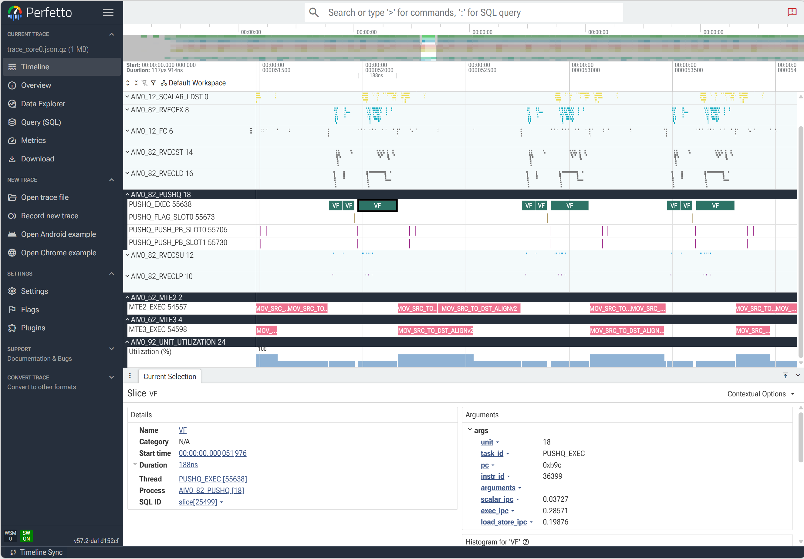
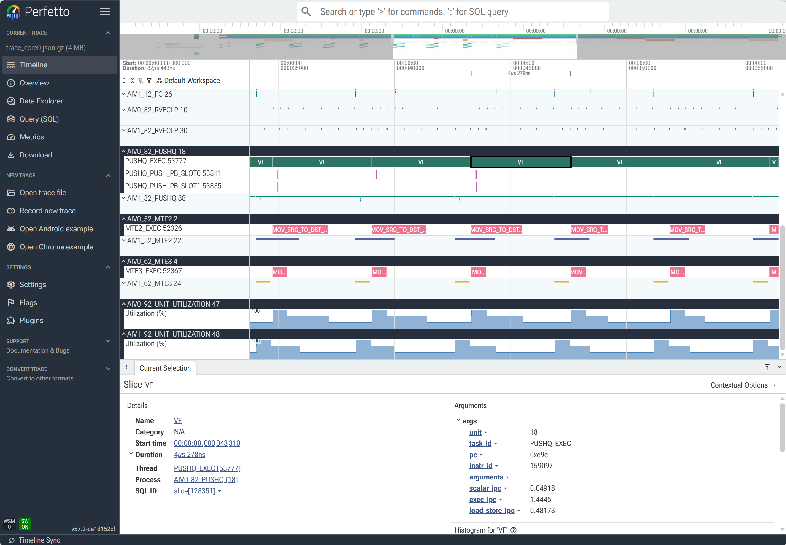

# 典型案例

本章描述的案例都来源于 [CANN Samples](https://gitcode.com/cann/cann-samples) 仓库，可以先参考[环境安装](../quick_start/quick_install.md)章节安装对应的运行环境并下载样例代码。

```bash
git clone https://gitcode.com/cann/cann-samples.git
```

如需基于 `Samples/0_Introduction/matmul` 观察 `SET_FLAG` / `WAIT_FLAG`、`GET_BUF` / `RLS_BUF`，可参考[基于 Matmul 样例观察同步与 Buffer 依赖](./matmul_sync_buffer.md)。

## VF（Vector Function）性能优化

### 概述

展示如何通过 NPUSim 工具的性能分析报告，分析VF算子的瓶颈点，并实现算子的性能优化

### 操作步骤

1、编译[rms_norm_quant_story](https://gitcode.com/cann/cann-samples/tree/master/Samples/2_Performance/rms_norm_quant_story)样例算子，由于仿真执行速度相比于上板差异比较大，为了节省时间，先将示例代码中得shape调小再进行编译。
```bash
# 调整样例0_naive.asc代码中shape大小
size_t a = 256;
size_t r = 512;

# 进入项目根目录，执行编译
cd ~/cann-samples
cmake -S . -B build -DNPU_ARCH=dav-3510
cmake --build build --target rms_norm_quant_story
```

2、运行rms_norm_quant_0_naive仿真，分析对应的性能报告，指令流水图说明可参考[用户指南](../user_guide/01_user_guide.md#指令流水图)，AiCore利用率等其他报告的说明可参考[用户指南](../user_guide/01_user_guide.md#aicore利用率报告)。
```bash
# 进入build目录
cd build/Samples/2_Performance/rms_norm_quant_story
# 运行仿真
npusim record -s Ascend950 ./rms_norm_quant_0_naive -g
```
- 查看core0的指令流水图，使用perfetto打开trace_core0.json，可以看到只有core0的AIV0在运行，其他核心都是空闲，另外VF的执行IPC偏低约0.3左右，且 数据搬运 与 计算 交替执行、无重叠。示例图如下：



3、针对上述的问题，可以采用Gamma 预加载、多核并行、寄存器数据流、Double Buffer、UB 多行批处理等方式进行算子的优化，具体优化代码可以参考[rms_norm_quant_story](https://gitcode.com/cann/cann-samples/tree/master/Samples/2_Performance/rms_norm_quant_story)样例。

4、直接运行rms_norm_quant_5_ub_utilization仿真，查看最终优化结果。
```bash
npusim record -s Ascend950 ./rms_norm_quant_5_ub_utilization -g
```
- 查看core0的指令流水图，使用perfetto打开trace_core0.json，可以看到core0的AIV0和AIV1都已经运行，VF的执行IPC已经提升到1.4左右，且数据搬运与计算是并行，示例图如下：



## matmul性能优化

### 概述

展示如何通过NPUSim工具的性能分析报告，分析matmul算子的瓶颈点，并实现算子的性能优化

### 操作步骤

1、编译[matmul](https://gitcode.com/cann/cann-samples/tree/master/Samples/2_Performance/matmul_story/matmul_tutorials)样例算子,先编译0_naive，并生成输入数据。
```bash
# 进入项目根目录，执行编译
cd ~/cann-samples
cmake -S . -B build -DNPU_ARCH=dav-3510
cmake --build build --parallel
cmake --install build --prefix ./build_out
cd build_out/2_Performance/matmul_story/matmul_tutorials
# 生成输入数据与 CPU golden
python3 gen_data.py 256 256 256
```

2、运行matmul_tutorial_mxfp4_base仿真，观察结果。
```bash
npusim record -s Ascend950 ./matmul_tutorial_mxfp4_base -u '256 256 256' -g
```
- 查看core0的指令流水图，使用perfetto打开trace_core0.json，可以看到GM→L1 搬运与 L1→L0 搬运及 MMAD 计算 完全串行，流水没有重叠，硬件利用率低下。示意图如下：


3、针对上述问题，可以采用Double-Buffer、SWAT 调度优化等方法进行算子性能优化，具体参考[matmul_stroy](https://gitcode.com/cann/cann-samples/tree/master/Samples/2_Performance/matmul_story/matmul_tutorials)样例代码。

4、问题修复后，运行仿真，查看最终结果。
```bash
npusim record -s Ascend950 ./matmul_tutorial_mxfp4_a_fullload -u '256 256 256' -g
```

- 查看core0的指令流水图，使用perfetto打开trace_core0.json，可以看到流水已经并行，硬件利用率提升，示意图如下：
