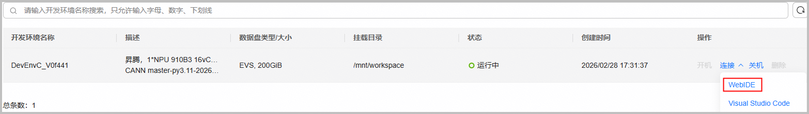

# 环境安装

本项目提供多种搭建昇腾环境的方式，请按需选择。

|  安装方式  |  使用说明  |  使用场景  |
| ----- | ------ | ------ |
|  Web IDE  | 一站式开发平台，提供在线直接运行的昇腾环境，无需手动安装。<br>当前可提供单机算力，**默认安装最新商用发布版的CANN软件包**。 | 适用于没有服务器设备的开发者。|
|  手动安装  | 按照本文中[方式2：手动安装](#section_manual_install)进行环境准备 |适用有服务器，想体验手动安装CANN包的开发者。|

## 方式1：Web IDE环境

对于无昇腾设备的开发者，可直接使用Web IDE开发平台，即“**一站式开发平台**”，该平台为您提供在线可直接运行的昇腾环境，环境中已安装必备的驱动固件、软件包和依赖，无需手动安装。更多关于开发平台的介绍请参考[LINK](https://gitcode.com/org/cann/discussions/54)。

1. 进入开源项目，单击“`CANNLab`”按钮，使用已认证过的华为云账号登录。若未注册或认证，请根据页面提示进行注册和认证。

   

2. 根据页面提示创建并启动云开发环境，单击“`连接 > WebIDE `”进入一站式开发平台，开源项目的源码资源默认在`/mnt/workspace`目录下。

   

环境部署完成后，请继续以下步骤：

**编译并安装 NPUSim**

   Web IDE 环境已预装 CANN（含 NPUSim）。如需使用本仓库最新代码，请编译 whl 并覆盖安装：

   ```bash
   bash ./clear.sh && bash ./build_wheel.sh
   pip3 install dist/*.whl --upgrade -t /usr/local/Ascend/python/site-packages/
   ```

   安装完成后执行 `npusim --help` 验证是否生效。

## 方式2：手动安装

### 软件安装

**安装CANN软件包**

请单击[下载链接](https://ascend.devcloud.huaweicloud.com/artifactory/cann-run-mirror/software/master/)，选择最新时间版本，并根据产品型号和环境架构下载对应包。安装命令如下，更多指导参考《[CANN软件安装指南](https://www.hiascend.com/document/redirect/CannCommunityInstWizard)》。

1. 安装CANN toolkit软件包

   ```bash
   # 确保安装包具有可执行权限
   chmod +x Ascend-cann-toolkit_${cann_version}_linux-${arch}.run
   # 安装命令
   ./Ascend-cann-toolkit_${cann_version}_linux-${arch}.run --install --install-path=${install_path}
   ```

2. 安装CANN ops软件包（可选）

   如果算子运行依赖，可选择安装ops软件包。

   ```bash
   # 确保安装包具有可执行权限
   chmod +x Ascend-cann-${soc_name}-ops_${cann_version}_linux-${arch}.run
   # 安装命令
   ./Ascend-cann-${soc_name}-ops_${cann_version}_linux-${arch}.run --install --install-path=${install_path}
   ```

   - \$\{cann\_version\}：表示CANN软件包的版本号。
   - \$\{arch\}：表示CPU架构，如aarch64、x86_64。
   - \$\{soc\_name\}：表示NPU型号名称，当前支持 `Ascend950`。
   - \$\{install\_path\}：表示指定安装路径，ops包需与toolkit包安装在相同路径，root用户默认安装在`/usr/local/Ascend`目录。

环境部署完成后，请继续以下步骤：

**编译并安装 NPUSim**

   CANN 包中已自带 NPUSim，如需使用本仓库最新代码，请编译 whl 并覆盖安装：

   ```bash
   # 进入项目根目录编译
   bash ./clear.sh && bash ./build_wheel.sh
   # 覆盖安装到 CANN 的 Python 目录（覆盖 CANN 自带的 NPUSim）
   pip3 install dist/*.whl --upgrade -t ${install_path}/python/site-packages/
   ```

   - \$\{install\_path\}：与 CANN 安装路径一致，root 用户默认为 `/usr/local/Ascend`。
   - 安装完成后执行 `npusim --help` 验证是否生效。

## 安装 Python 依赖

使用 `pip3 install -t`（目标目录）方式安装 NPUSim whl 时，NPUSim 核心功能（仿真数据采集与基于 `prof_demo` 的性能报告生成）完全基于 Python 标准库实现，**零外部第三方依赖**，无需安装第三方 Python 库即可直接运行。

> 说明：如需运行仓库内置的某些性能测试样例造数脚本（如 `tests/st/` 部分用例），可按需安装 `numpy` 进行输入数据生成：
> ```bash
> pip3 install "numpy>=1.21"
> ```
