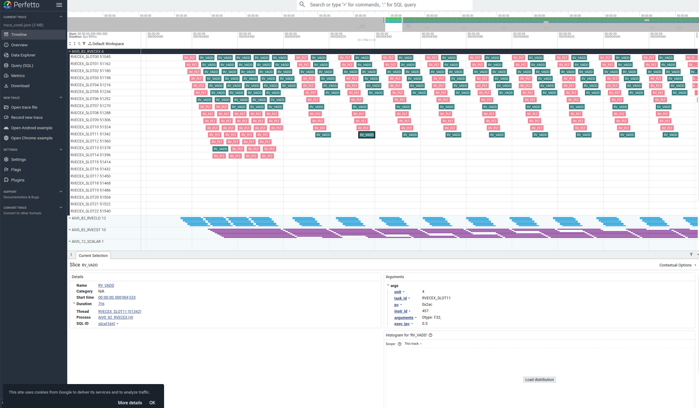
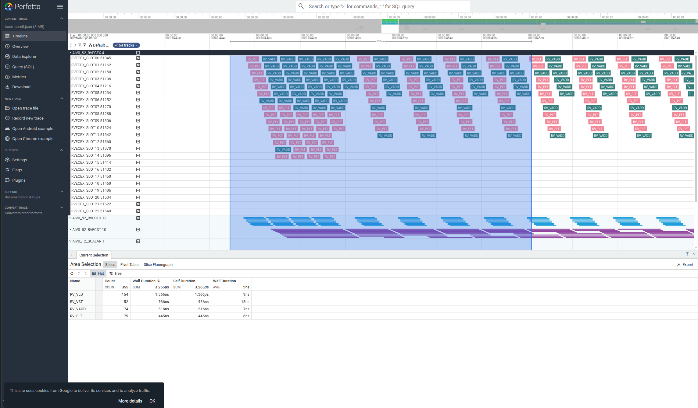

# 使用指南

NPUSim支持两种模式的操作：
- **record** 模式，通过仿真模型运行目标应用程序，并采集仿真过程中的数据
- **report** 模式，后处理已采集的仿真数据生成仿真视图供操作员进行性能分析使用

命令详细说明可以使用如下命令进行查看

```bash
npusim --help
```
---

## 数据采集（record模式）

基于仿真运行目标程序，采集数据，目标程序可以是可执行文件、shell脚本、python脚本等。

**命令格式**：
- npusim record [options] {user_app}

**命令参数**

|参数|可选/必选|说明|
| --- | --- | --- |
|--soc-version 或 -s | 必选 | 指定模拟目标芯片版本（如：Ascend950）。ktest 模式（-c）下不可指定。|
|--output 或 -o | 可选 | 生成文件所在路径，可配置为绝对路径或者相对路径，并且执行工具的用户需要具有读写权限。如果未指定路径，则默认在当前目录下保存数据。|
|--gen-report 或 -g | 可选 | 启用仿真完成后是否进行自动解析，并生成分析报告。默认不自动解析。使用 `-g vf` 可在生成报告的同时额外导出 VF IPC JSON。|
|--user-option 或 -u | 可选 | 用户自定义算子参数，以命令行选项形式传递给算子程序。|
|--core-id 或 -n | 可选 | 仿真期间启用日志的AI Core，格式同 report -n：`all`（全核，信息完整但日志量大）、`0-2,12-14`（指定核区间，聚焦关键核兼顾覆盖与效率）、`5`（单核，日志最小分析最快但无法发现跨核问题）。默认全开；配合 -g 且未指定时回退到 core 0。|
|--case-dir 或 -c | 可选 | ktest 模式：指定用例目录，工具以 `camodel ./sim` 方式运行仿真，并将该目录软链接为 `case`（用例目录需含 top.json，用于探测芯片数量）。指定后 user_app 与 -s/--soc-version 不可同时使用。|
|--pv | 可选 | 使用程序员视图（PV）仿真：仅做功能仿真，速度更快，不包含精确时序信息，适合功能验证场景。未指定时默认使用精确时序（CA）仿真。|
|user_app|必选|待运行的算子程序或命令（如 ./app, python train.py, bash run.sh）。ktest 模式（-c）下不可指定。|

命令详细说明可以使用如下命令进行查看

```bash
npusim record --help
```

**使用示例**
1. 完成算子开发和编译。
2. 执行仿真命令，可参考以下使用示例

    ```bash
    # 方式一（推荐）：启用仿真采集并自动生成报告，用于后续性能分析
    $ npusim record /path/to/app -o ./output -s Ascend950 --gen-report

    # 方式二：仅仿真采集，不生成报告（如后续需手动执行 npusim report 再生成）
    $ npusim record /path/to/app -o ./output -s Ascend950
    ```

3. 命令完成后，会在默认路径或指定的“output”目录下生成以“`npusim_{timestamp}_${user_app}`”命名的文件夹，结构示例如下：

    ```text
    npusim_{timestamp}_{user_app}
    ├── npusim.log                         # 仿真主日志（含精度对比结果）
    └── record/                            # 录制产物目录
        ├── *.db                           # cannsim_helper SQLite DB（report 阶段的优先数据源，多卡场景为 chip*.db）
        └── cannsim_helper.log             # cannsim_helper 库运行日志（诊断用）
    ```

    | 产物 | 说明 |
    | --- | --- |
    | `npusim.log` | 仿真主日志，包含启动参数、执行阶段记录、算子精度对比结果及告警信息。 |
    | `record/*.db` | cannsim_helper 生成的 SQLite 数据库，包含指令计数、IPC、存储利用率等结构化数据。 |
    | `record/cannsim_helper.log` | cannsim_helper 动态库的运行日志，用于排查数据采集阶段的问题。 |

4. 用户可以获取算子执行结果，并进行精度的对比，结果展示在`npusim.log`，示例如下

    以下输出为 Ascend C 单算子直调精度比较结果实录，节选自本仓库 [tests/st/Samples/0_Introduction/matmul](../../../tests/st/Samples/0_Introduction/matmul/main.asc) 样例（复现命令：`npusim record -s Ascend950 ./matmul -u '256 256 256' -g`）的仿真日志；因算子与版本不同略有差异，请以实际输出为准。

    ```text
    max abs diff: 0.0
    point error count(>0.1): 0/65536
    ratio error count(>0.001): 0/65536, error ratio: 0.000000
    [PASS] NPU results are consistent with CPU.

    Parallel Simulation: All threads are joined.
    ```

5. 查看算子仿真结果，参考[数据分析（report模式）](#数据分析report模式)。
---

## 数据分析（report模式）

基于采集到的数据生成性能分析报告，如指令流水图、AI Core 利用率报告、性能分析汇总等。

> 说明：性能分析报告模块基于 Python 标准库实现，输出标准 Chrome Tracing JSON（指令流水图、AI Core 利用率）及结构化分析汇总（summary.json），无需安装第三方绘图库。指令流水图可直接使用 [Perfetto](https://ui.perfetto.dev) 或 Chrome 浏览器打开查看。

**命令格式：**
- npusim report [options]

**命令参数**

|参数 | 可选/必选 | 说明|
| --- | --- | --- |
|--export 或 -e | 必选 | 仿真执行结果目录，指定到`npusim_{timestamp}_${user_app}`层，可配置为绝对路径或者相对路径，且执行用户需具有读写权限。|
|--output 或 -o | 可选 | 指令流水图输出目录，可配置为绝对路径或者相对路径，且执行用户需具有读写权限。若未指定路径，默认与 export 目录相同。|
|--core-id 或 -n | 可选 | 指定生成指令流水的核ID，支持格式：`all`（全核，信息完整但日志量大）、`0-2,12-14`（指定核区间，聚焦关键核兼顾覆盖与效率）、`5`（单核，日志最小分析最快但无法发现跨核问题）。不指定默认生成0核的指令流水。|

命令详细说明可以使用如下命令进行查看

```bash
npusim report --help
```

**使用示例**
1. 参考仿真执行算子仿真，对比输出示例，确保对应的结果执行正确。
2. 执行仿真结果解析命令，可参考以下执行用例。

    ```bash
    # 在当前目录下生成性能分析报告（默认仅分析核0）
    npusim report -e /path/to/npusim_{timestamp}_${user_app}

    # 在指定目录下生成核0、核1、核11、核12的性能分析报告
    npusim report -e /path/to/npusim_{timestamp}_${user_app} -o /path/to/report -n '0-1, 11-12'
    ```

3. 命令执行完后，会在output配置的目录下生成对应的流水文件，文件格式为json格式，输出结果示例如下：

    ```text
    npusim_{timestamp}_{user_app}
    ├── record/                                        # 录制产物（见 record 模式说明）
    ├── npusim.log                                     # 仿真主日志
    └── report/
        └── results/
            └── kernel_*_reports/                      # 按 kernel launch 分类，每个 kernel 一个目录
                ├── aicore_utilization.json            # AiCore 利用率（Chrome Tracing JSON）
                ├── summary.json                       # 性能分析汇总（结构化 JSON，面向 AI/工具消费）
                ├── core_0/                            # 按 core 分组的 per-core 报告
                │   └── trace_core0.json               # 指令流水图（Chrome Tracing JSON）
                ├── core_1/
                │   └── ...
                └── ...
    ```

    | 产物 | 说明 |
    | --- | --- |
    | `kernel_*_reports/aicore_utilization.json` | AI Core 利用率报告，展示各子核心（AIC/AIV0/AIV1）的活跃区间与占用率。详见 [AI Core利用率](#AICore利用率报告)。 |
    | `kernel_*_reports/summary.json` | 性能分析汇总，归一化聚合内核耗时、各流水线利用率、瓶颈诊断等维度，纯 JSON 面向 AI/工具消费。详见 [性能分析汇总](#性能分析汇总)。 |
    | `core_*/trace_core*.json` | 指令流水图（标准 Chrome Tracing JSON），以指令维度展示时序关系，可用 Perfetto 或 Chrome 打开。详见 [指令流水图](#指令流水图)。 |


4. 仿真结果查看
- 将trace_core*.json文件导入Chrome浏览器（在地址栏输入`chrome://tracing`）或[Perfetto](https://ui.perfetto.dev)后，将会展示指令流水图，流水图说明详见[指令流水图](#指令流水图)章节。

### AICore利用率报告

**功能说明**

AI Core利用率报告以事件形式记录 kernel 执行期间每个 AI Core 各子核心（AIC矩阵计算核、AIV0/AIV1向量核）的活跃区间与占用率。每个子核心对应一条事件记录，包含所属核号（pid）、子核心类型（tid/name）、活跃起始时间（ts，微秒）、活跃时长（dur，微秒）及占用率百分比（args.utilization）。占用率基于子核心首条指令到末条指令的时间跨度（而非指令耗时累加）占整个kernel执行窗口的比例计算。

通过对比各子核心的占用率数值与活跃时间区间，可评估子核心的利用充分程度与并行性：占用率接近100%且各子核心活跃区间高度重叠，说明计算与向量搬运充分并行；占用率明显偏低或活跃区间相互错开，则存在串行等待或空闲。

### 性能分析汇总

**功能说明**

性能分析汇总报告（summary.json）以结构化 JSON 格式聚合单次 kernel 仿真的关键性能指标，无需可视化工具即可直接解析，适合 AI/工具消费与批量自动化瓶颈分析。主要包含以下维度：

- `kernel_info`：内核基础信息，包括活跃 AI Core 数（ai_core_active）、总时钟周期（kernel_total_clocks）、主频（frequency_ghz）与执行指令数（kernel_instructions_executed），用于快速估算 kernel 规模与执行时长。
- `pipe_utilization`：各流水线（SCALAR/CUBE/MTE1/MTE2/FIXP 等）利用率统计，每条流水线给出 mean/max/min 及 per_core 逐核数值。
- `top_level_diagnosis`：瓶颈诊断结论，包括主导流水线（dominant_pipeline）、主导流水线利用率（dominant_pipeline_util）与流水线不均衡比（imbalance_ratio），可据此快速定位优化方向。
- `scalar_instructions`：按子核心类型（AIC/AIV）统计的标量指令计数，含总数（total_count）、load/store 计数（load_count/store_count）与读写比（load_store_ratio）。
- `aiv_vector_instructions`：向量指令统计，含 RVEC 系列指令计数（RVECEX/RVECLD/RVECST）与 UB 流量占比（ub_traffic_ratio）；kernel 含 SIMD/SIMT 向量执行时，还输出对应平均 IPC（如 SIMD_ScalarIPC、SIMD_ExecIPC、SIMT_ExecIPC、SIMT_BranchIPC 等）。
- `cache`：缓存指标，含 ICache refill 次数（icache_refill_count）与 refill 耗时（icache_refill_ticks，无 refill 时为 null）。
- `bandwidth`：各搬运路径（如 MTE2 OUT→L1、L1→L0A/L0B、FIXPIPE L0C→OUT）的带宽统计，每条路径含总带宽（total_gbps）、带宽利用率（bandwidth_utilization）、平均单次传输带宽（avg_transaction_gbps）与传输次数（transaction_count）；无流量的路径对应条目为 null。
- `pipeline_overlap`：计算与搬运流水线之间的重叠率，用于判断访存与计算是否充分并行：重叠率低说明搬运与计算交替执行，存在可优化的流水线空泡；无对应流水线活动的条目为 null。
- `simd_vf_metrics`：VF（向量函数）执行统计与 stall 指标，含 VF 执行次数、活跃核数、平均/最大/最小执行周期、exec IPC、stall 事件数/周期数与 stall 占比等。该字段始终存在，kernel 不含 VF 指令时为空对象 `{}`。

### 指令流水图

**功能说明**

指令流水图以指令维度展示时序关系，并关联调用栈快速定位瓶颈位置。

**使用说明**

trace_core*.json文件为标准Chrome Tracing JSON，建议优先使用Perfetto打开查看，也可通过Chrome浏览器打开。

- **Perfetto（推荐）**：Perfetto 是一款开源的 trace 可视化分析工具。访问 https://ui.perfetto.dev ，点击“Open trace file”将trace_core*.json导入即可。Perfetto支持大文件加载、多泳道筛选与SQL查询，体验优于Chrome内置tracing。浏览器对单页面的运行时内存限制通常约为 **2GB**（因浏览器、操作系统和架构而异），且 trace 加载后的运行时内存表示通常大于原始文件大小，文件过大时可能加载失败（参见 [Perfetto 大文件文档](https://perfetto.dev/docs/visualization/large-traces)）。打开后效果如下图所示。




- **Chrome浏览器**：在地址栏输入“chrome://tracing”，并将指令流水图文件（trace_core*.json）拖到空白处打开，键盘上输入快捷键（W：放大，S：缩小，A：左移，D：右移）可进行查看。

关键字段说明如[**表 1**  关键字段说明](#关键字段说明)。

**表 1**  关键字段说明<a id="关键字段说明"></a>

|字段名|字段含义|
|---|---|
|Scalar|标量运算单元。|
|Vector|向量运算单元。
|Cube|矩阵乘运算单元。|
|MTE1|数据搬运流水，数据搬运方向为：L1 ->{L0A/L0B, UBUF}。|
|MTE2|数据搬运流水，数据搬运方向为：{DDR/GM, L2} ->{L1, L0A/B, UBUF}。|
|MTE3|数据搬运流水，数据搬运方向为：UBUF -> {DDR/GM, L2, L1}、L1->{DDR/L2}。|
|FIXP|数据搬运流水，数据搬运方向为：FIXPIPE L0C -> OUT/L1。（仅支持该流水展示的公开目标支持展示）|
|FLOWCTRL|控制流指令。|
|CACHEMISS|未命中ICache。|
|USEMASK|自定义打点范围。若同一个USEMASK内存在范围嵌套或只有TRACE_START无TRACE_STOP时，不能正常绘制指令流水图。|
|PUSHQ|VF/SMIT_VF类指令。|
|RVECLP|vector寄存器LOOP指令。|
|RVECSU|vector寄存器ASU指令，包含跳转和标量数据处理。|
|RVECLD|vector寄存器LOAD指令。|
|RVECEX|vector寄存器EXECUTE指令。|
|RVECST|vector寄存器SET指令。|

指令流水图中每个轨道（Perfetto/Chrome Tracing 中的泳道）的名称由“核心类型_流水线分组+区段_指令类型”组合而成，例如 `AIC_CUBEINSTR_CUBE` 表示 AIC 核 Cube 流水线的指令执行轨道。各轨道名含义见[**表 2**  轨道名说明](#轨道名说明)。

**表 2**  轨道名说明<a id="轨道名说明"></a>

|轨道名（模式）|含义|
|---|---|
|AIC / AIV0 / AIV1|核心类型前缀：矩阵计算核 / 向量核0 / 向量核1，轨道按子核心分组|
|INSTR / PRE / POST|区段后缀：指令执行区段 / 前置区段 / 后置区段|
|CUBE / SCALAR / SCALAR_LDST / MTE1 / MTE2 / MTE3 / FIXP / PUSHQ|主流水线指令执行轨道，指令含义见[表 1](#关键字段说明)；其中 `SCALAR_LDST` 为标量 load/store 指令单独拆出的轨道|
|RVECEX / RVECLP / RVECSU / RVECST / RVECLD|vector 寄存器各类指令执行轨道，含义见[表 1](#关键字段说明)|
|WARP00 / WARP01 ...|SIMT 模式下按 warp 划分的向量指令轨道，每个 warp 一条|
|*_DISPATCH|指令调度轨道，展示指令从派发到进入执行流水的时间|
|*_QUEUE_EVENTS|队列满停顿事件轨道，标记 `QUEUE FULL` 导致的阻塞|
|*_ICACHE_EVENTS|ICache 事件轨道，含 `ICACHE REFILL`/`ICACHE_HIT`/`ICACHE_MISS`|
|*_DCACHE_EVENTS|DCache 事件轨道，含 `DCACHE REFILL`/`DCACHE_HIT`/`DCACHE_MISS`|
|*_CUSTOM_TRACE|用户自定义打点（USEMASK）区间轨道|
|*_AUTO_TRACE|自动识别的代码区间打点轨道|
|*_UB_UTILIZATION / *_L1_UTILIZATION / *_L0A~L0C_UTILIZATION|UB/L1/L0A/L0B/L0C 各级存储利用率计数器轨道|
|*_UNIT_UTILIZATION|子核心单元利用率计数器轨道|
|*_ISSUE_QUEUE_UTILIZATION / *_EXEC_QUEUE_UTILIZATION|流水线派发队列 / 执行队列占用率计数器轨道|

---
