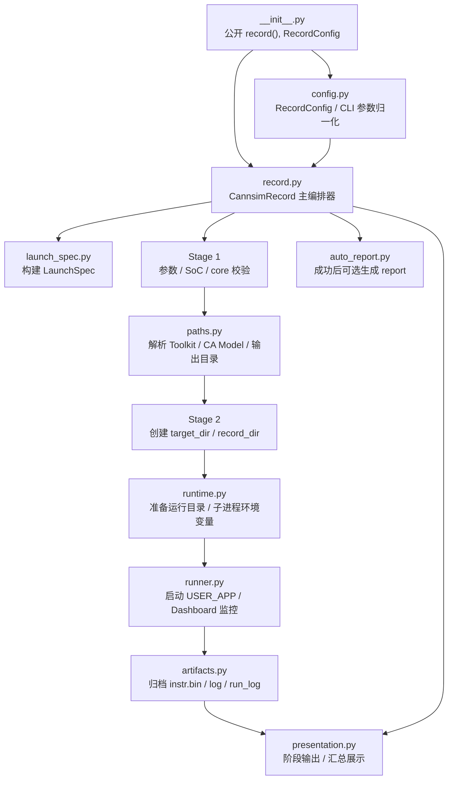

# record 模块

AscendC Kernel 仿真录制的核心编排层——将 CLI 参数解析、路径计算、子进程执行、产物归档、报告生成和终端展示拆分为独立职责的子模块，由 `record.py` 中的 `CannsimRecord` 按三阶段流水线串联。

## 目录结构

```
record/
├── __init__.py       # 公开入口：record(), RecordConfig
├── config.py         # RecordConfig 数据类 + CLI 参数归一化
├── paths.py          # Ascend 工具链 / CA Model / 输出目录路径解析
├── runtime.py        # 运行目录创建 + 子进程环境变量构建
├── launch_spec.py    # 用户应用输入归一化（LaunchSpec 数据类）
├── runner.py         # 子进程执行 + Dashboard 实时监控
├── artifacts.py      # 仿真产物归档 + 内部目录清理
├── auto_report.py    # 成功后自动触发报告生成
├── presentation.py   # 终端 UI：横幅、阶段标记、汇总块
├── record.py         # 主编排器（CannsimRecord 三阶段流水线）
```

## 模块流程图



## 三阶段流水线

`CannsimRecord.run()` 顺序执行三个阶段，任一阶段失败即终止：

| 阶段 | 方法 | 职责 | 关键依赖 |
|------|------|------|----------|
| Stage 1 | `stage1_parameter_check` | 验证 `RecordConfig` 参数合法性；解析 core 列表与 SoC 版本 | `config`, `soc_info` |
| Stage 2 | `stage2_define_paths` | 解析 Ascend 工具链路径、CA Model 路径、创建输出目录 | `paths` |
| Stage 3 | `stage3_execute` | 写入 SoC 元数据 → 准备运行目录 → 构建环境 → 执行子进程 → 归档产物 | `runtime`, `runner`, `artifacts` |

## 子模块详情

### config — 录制配置

- **`RecordConfig`** — dataclass，持有 CLI 转译后的所有录制参数：
  `user_app`, `output`, `soc_version`, `gen_report`, `user_option`, `object_file`, `core_id`
- **`build_record_config_from_args(args)`** — 从 argparse Namespace 构造 `RecordConfig`
- **`normalize_gen_report(raw)`** — 归一化 `--gen-report` 参数（`True → "true"`，`False → ""`，`"vf"` → `"vf"`）

### paths — 路径解析

- **`RecordPaths`** — frozen dataclass：`ascend_toolkit_path`, `ca_model_path`, `target_dir`, `record_dir`, `cannsim_log`
- **`resolve_record_paths(output, soc_version, launch)`** — 读取 `ASCEND_TOOLKIT_HOME` 环境变量，构造 CA Model 路径，创建时间戳命名的 `target_dir` 与 `record_dir`
- **`RecordPathError`** — 自定义异常，携带 `context` 字典用于诊断输出

### runtime — 运行环境

- **`prepare_runtime_dirs(app_cwd, target_dir)`** — 在 `app_cwd` 下创建 `log/`, `log/ub_log/`, `run_log/`；在 `target_dir` 下创建 `record/log_ca/`
- **`build_execution_env(...)`** — 构建子进程环境：向 `LD_LIBRARY_PATH` 注入 CA Model 路径，设置 `CORE_ENABLE_MASK`（十六进制掩码），`CAMODEL_LOG_PATH`，`STARS_LOG_PATH`；对 Python 启动设置 `TASK_QUEUE_ENABLE=0`

### launch_spec — 启动规格

- **`LaunchSpec`** — frozen dataclass：`raw`, `kind`（binary / script / command），`label`, `argv`, `cwd`, `asset_roots`, `is_python`, `executable_path`
- **`build_launch_spec(raw_user_app, user_option, cwd)`** — 判断用户输入是本地文件还是 shell 命令，自动检测 ELF / Python / Shell 脚本，生成结构化启动规格

### runner — 子进程执行

- **`RunResult`** — dataclass：`success`, `dashboard`, `stderr_tail`, `interrupted`, `returncode`
- **`run_user_app_with_dashboard(argv, env, cwd, log_path, title)`** — 以 `start_new_session=True` 启动子进程；stdout/stderr 读线程同时写日志并喂给 Dashboard；`KeyboardInterrupt` 时终止进程组（SIGTERM → SIGKILL 逐级升级）

### artifacts — 产物归档

- **`archive_assets(record_dir, asset_names, asset_roots, on_fail_delete)`** — 将仿真产物从运行目录移至 `record_dir`；若 `record_dir` 不可用且 `on_fail_delete=True`，则删除残留产物
- **`cleanup_internal_dirs(record_dir)`** — 收尾清理工具：从归档目录移除 `log/`, `log_ca/`, `run_log/`；主录制流程在 summary / auto-report 后自动调用

### auto_report — 自动报告

- **`generate_auto_report(record_dir, target_dir, gen_report, core_id, object_file)`** — 在录制成功后调用 `report.generate_report`；当 `gen_report == "vf"` 时启用 `export_vf`

### presentation — 终端展示

- 横幅：`print_start_banner()`
- 阶段标记：`print_stage_ok(idx, name, extra)` / `print_stage_fail(idx, reason, context)`
- Stage 3 前置：`print_stage3_preamble(...)` — 参考基准表 + 启动规格摘要
- 汇总：`print_record_summary(state, success)` — 状态行、产物位置、警告、失败日志尾部、下一步提示
- 辅助：`fmt_accent()`, `now_local_str()`, `fmt_returncode()`

## 使用方式

```python
from pathlib import Path

from npusim.core.record import record, RecordConfig

cfg = RecordConfig(
    user_app="./my_kernel",
    output=Path("./out"),
    soc_version="Ascend950",
    gen_report="true",
    user_option="",
    object_file="",
    core_id="0",
)

result = record(cfg)   # 运行三阶段流水线，打印终端 UI
```

## 设计要点

1. **职责分离** — 配置、路径、环境、执行、归档、报告、展示各自独立子模块；`record.py` 仅做编排。
2. **结构化数据传递** — 阶段间通过 `RecordConfig` / `RecordPaths` / `LaunchSpec` / `RunResult` 等 dataclass 传递；其中路径与启动规格使用 frozen dataclass 表达不可变结果。
3. **优雅中断** — `runner` 将 `KeyboardInterrupt` 转化为进程组终止；`CannsimRecord` 记录中断状态并在汇总中展示已捕获的进度。
4. **CI 友好** — 设置 `NPUSIM_NO_DELAY=1` 可跳过阶段间延迟，加速自动化场景；旧变量 `CANNSIM_NO_DELAY=1` 仍兼容。
